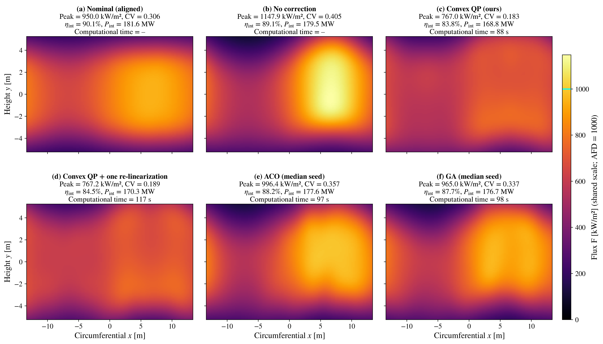

# Optimizing Heat Flux Density for Solar Tower Power Plants

Reference implementation of the convex aim-point correction method described in

> D. Sajedi-Hosseini, K. Fujisawa and X. Shen, *"Optimizing Heat Flux Density for Solar Tower
> Power Plants: A Novel HFLCAL Linearization Approach"*, Renewable Energy
> (manuscript RENE-D-26-10794, under revision), Tokyo University of Agriculture and Technology
> and Institute of Science Tokyo.

Slow structural drift, such as foundation settlement, soil erosion and mechanical wear, misaligns
heliostats. On a cylindrical receiver surrounded by a circular field, the displaced aim-points
**converge onto a single meridian** and create a hot spot that can exceed the receiver's allowable
flux density (AFD).

This repository corrects that hot spot by convex optimization. Linearizing the HFLCAL flux model to
first order about the *misaligned* aim-points turns the non-convex flux-shaping problem into a
**quadratic program** in which the AFD is a **hard constraint**. The program is solved to global
optimality (of the linearized problem) for the whole plant at once, over all `2K = 5300` continuous
correction variables, and every result is evaluated on the exact flux.



## Results

The case study is a full-scale model of the **Gemasolar** plant (Fuentes de Andalucía, Spain): 2,650
heliostats, a molten-salt cylindrical receiver, AFD = 1000 kW/m², 128 × 128 receiver pixels, at
spring-equinox solar noon. The nominal aiming-factor strategy is tuned so that the aligned plant runs
at 95 % of the AFD. The structural drift (1 m per heliostat) converges on the **North meridian**, the
worst case for this plant.

| Method | Peak [kW/m²] | CV [–] | η_int [%] | Time [s] |
|---|---|---|---|---|
| Nominal (aligned) | 950.0 | 0.306 | 90.1 | – |
| Misaligned, uncorrected | 1147.9 | 0.405 | 89.1 | – |
| **Convex QP (this work)** | **767.0** | **0.183** | 83.8 | 88 |
| Convex QP + one re-linearization | 767.2 | 0.189 | 84.5 | 117 |
| ACO (bounded, equal budget, 5 seeds) | 996.4 ± 2.7 | 0.358 ± 0.003 | 88.1 | 97 |
| GA (bounded, equal budget, 5 seeds) | 971.5 ± 7.8 | 0.336 ± 0.004 | 87.5 | 98 |

CV is the coefficient of variation of the flux over the illuminated receiver (lower is flatter);
η_int is the interception efficiency, the fraction of the power delivered by the field that lands on
the receiver.

The drift pushes the plant 14.8 % above its thermal limit. The convex correction restores a 23 % margin
below the limit and cuts the non-uniformity by 55 %. The two metaheuristic baselines, given the **same
wall-clock budget** and identical misalignment, bounds and reference profile, only just recover
feasibility and end the budget at 1.8–2.0 times the QP's non-uniformity; finer groupings, up to a
per-heliostat search, and up to ten times the budget do not close the gap (best baseline CV 0.319). The notebook also contains the
validation of the flux model against a published ray-tracing round-robin, the validity of the
linearization, a flow-path AFD profile, the uniformity–interception trade-off, five operating
conditions, a clear-sky annual estimate, the Phase-1/Phase-2 decoupling analysis and the scaling of
the baselines.

## Installation

Requires Python ≥ 3.10 (3.12 was used for the published run). Use either conda or a plain virtual
environment.

### Option A: conda

```bash
conda env create -f environment.yml
conda activate solar-main
python -m ipykernel install --user --name solar-main --display-name "Python (solar-main)"
```

On Windows, use the **Anaconda PowerShell Prompt**; a plain PowerShell needs `conda init powershell`,
run once and followed by a restart, before `conda activate` works.

### Option B: venv

```bash
python -m venv .venv-solar
source .venv-solar/bin/activate          # Windows: .\.venv-solar\Scripts\Activate.ps1
python -m pip install --upgrade pip
python -m pip install -r requirements.txt
python -m ipykernel install --user --name solar-main --display-name "Python (solar-main)"
```

Then launch Jupyter and select the **"Python (solar-main)"** kernel:

```bash
jupyter lab
```

## Running

Open `solar_tower_qp.ipynb` and run the cells **from top to bottom**; each section uses the state of
the previous ones. The run settings are in the `RUN` dictionary of Section 0, and the model parameters
in `GEMASOLAR` and `DEFAULT_CFG` of Section 1.

**Runtime.** Sections 0–15 take about two hours on a 4-core laptop CPU; the scaling study of the
baselines (Section 16) takes about six more hours. Set `RUN['scaling'] = False` to skip it.

**Outputs.** Every number quoted in the manuscript is written to `results_R1.json`, and every figure to
`figures/`.

**Reproducibility.** The flux model, the QP and all sweeps are deterministic (all random draws are
seeded). The metaheuristic baselines are budgeted in wall-clock time, so on faster or slower hardware
they complete a different number of generations and their figures move slightly; the QP results do not.

## Solver note

The QP is solved with **Clarabel** (interior point), called directly with sparse data. First-order
methods such as OSQP do not reach the requested tolerance at this problem size within their iteration
limit; this is a property of first-order splitting methods on a dense, ill-conditioned Hessian, not of
the formulation, which is a well-posed convex QP.

## Repository contents

| File | Description |
|---|---|
| `solar_tower_qp.ipynb` | The complete implementation, with stored outputs. |
| `results_R1.json` | All numbers quoted in the manuscript, written by the notebook. |
| `figures/` | All computed figures of the manuscript, written by the notebook (the schematic drawings are not included). |
| `model_equations.md` | The equations implemented, numbered as in the manuscript. |
| `requirements.txt`, `environment.yml` | Pinned, tested dependencies. |
| `CITATION.cff`, `LICENSE` | Citation metadata; MIT license. |

Modeling assumptions and known limitations are listed in the final section of the notebook.

## Citing

If you use this code, please cite the manuscript above. The full citation will be added here once
the paper is published.

## License

Released under the MIT License; see [LICENSE](LICENSE).
