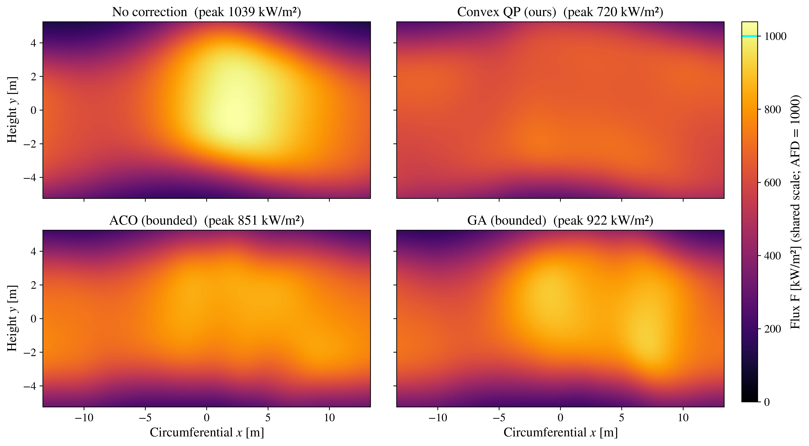

# Optimizing Heat Flux Density for Solar Tower Power Plants

Reference implementation of the convex aim-point correction method described in

> D. Sajedi-Hosseini and X. Shen, *"Optimizing Heat Flux Density for Solar Tower
> Power Plants: A Novel HFLCAL Linearization Approach"* (manuscript under review),
> Tokyo University of Agriculture and Technology.

Slow structural drift — foundation settlement, soil erosion, mechanical wear —
misaligns heliostats. On a cylindrical receiver surrounded by a circular field, the
resulting aim-point displacements **converge onto a single meridian** and pile flux
into a hot spot that can exceed the receiver's allowable flux density (AFD).

This repository corrects that hot spot by convex optimization. Linearizing the
HFLCAL flux model to first order about the *misaligned* aim-point configuration turns
the non-convex flux-shaping problem into a **quadratic program** in which the AFD is
a **hard constraint** and the global optimum is certified — solved for the whole
plant at once, over all `2K = 5300` continuous correction variables.



## Results

The case study is the real **Gemasolar** plant (Fuentes de Andalucía, Spain): 2,650
heliostats, molten-salt cylindrical receiver, AFD = 1000 kW/m², discretized to
128 × 128 receiver pixels, at spring-equinox solar noon. Nominal aiming is a
realistic aiming-factor strategy tuned so the aligned plant runs at 95 % of the AFD —
**feasible by design**, so the thermal-limit violation studied here is created by the
structural drift rather than assumed into the baseline.

| Method | Peak [kW/m²] | CV [–] | η_int [%] | Time [s] |
|---|---|---|---|---|
| Nominal (aligned) | 950.0 | 0.306 | 90.1 | — |
| Misaligned, uncorrected | 1039.1 | 0.349 | 89.0 | — |
| **Convex QP (this work)** | **720.5** | **0.149** | 83.8 | 142 |
| ACO (bounded, equal budget) | 850.8 | 0.266 | 88.5 | 152 |
| GA (bounded, equal budget) | 921.7 | 0.292 | 88.0 | 152 |

CV is the coefficient of variation of the flux over the illuminated receiver (lower
is flatter); η_int is the interception efficiency — the fraction of power delivered
by the field that lands on the receiver, i.e. the energy price of redistributing flux
toward the receiver edges.

The structural drift pushes the plant 3.9 % above its thermal limit. The convex
correction restores a 28 % margin below the limit and cuts non-uniformity by 57 %.
The two metaheuristic baselines, given the **same wall-clock budget** and the
identical misalignment, bounds and reference profile, also recover feasibility for a
violation of this size but plateau at 1.8–2× the QP's non-uniformity, without an
optimality certificate.

## Method

The notebook runs end to end as a single pipeline:

field geometry → solar position → per-heliostat HFLCAL optics → nominal aiming
strategy → structural misalignment → first-order linearization (validated against
finite differences) → convex QP under the AFD cap → bounded ACO and GA baselines →
comparison → Phase-1 / Phase-2 decoupling study.

Three implementation points make the full-scale problem tractable, all validated to
give the same optimum as a dense reference formulation:

1. **Separable-Gaussian assembly.** Each HFLCAL spot factors as
   `exp(−Δx²/2σ²)·exp(−Δy²/2σ²)`, so a flux evaluation is one `(n_v×K)@(K×n_h)`
   matrix product, and each block of the Hessian `AᵀA` is a Hadamard product of two
   small Gram matrices. The `n_pixels × 2K` sensitivity matrix is never formed.
2. **Direct solver call.** The QP is handed to CLARABEL as sparse data, skipping
   modeling-layer canonicalization — a substantial overhead at 5,300 variables.
3. **Cutting-plane flux cap.** Cap rows are imposed on a subsampled pixel grid, then
   re-checked on all candidate pixels and re-solved if violated, so the constraint
   holds exactly on the linear model.

Every reported metric is evaluated on the **true nonlinear flux** at the computed
corrections, never on the linearized surrogate that was optimized.

## Installation

Requires Python ≥ 3.10 (3.12 used for the published run). Choose either conda or a
plain virtual environment — don't mix them in one environment.

### Option A — conda

```bash
conda env create -f environment.yml
conda activate solar-main
python -m ipykernel install --user --name solar-main --display-name "Python (solar-main)"
```

On Windows, use the **Anaconda PowerShell Prompt**; a plain PowerShell needs
`conda init powershell` run once, followed by a restart, before `conda activate`
works.

### Option B — venv

```bash
python -m venv .venv-solar
source .venv-solar/bin/activate          # Windows: .\.venv-solar\Scripts\Activate.ps1
python -m pip install --upgrade pip
python -m pip install -r requirements.txt
python -m ipykernel install --user --name solar-main --display-name "Python (solar-main)"
```

Then launch Jupyter and select the **"Python (solar-main)"** kernel:

```bash
jupyter lab
```

## Running

Open `solar_tower_qp.ipynb` and run the cells **top to bottom** — each stage consumes
state from the previous one. Every knob lives in the `CONFIG` dictionary in Sec. 0;
the values as shipped are the ones that produce the table above.

**Runtime** was ≈ 18 min in total for the published run: the QP solve 142 s, each
metaheuristic baseline 152 s (equal to the QP's time by construction, plus a shared
10 s precomputation), and the Phase-1/2 oracle re-solves 489 s. That last item is by
far the largest — set `CONFIG['ind_oracle'] = False` to skip it, or lower
`CONFIG['ind_oracle_points']`.

**Reproducibility.** The QP, the flux model and the decoupling sweep are fully
deterministic (all random draws are seeded through `CONFIG`). The two metaheuristic
baselines are *wall-clock budgeted*, so on faster or slower hardware they complete a
different number of generations and their numbers will move slightly. This is
inherent to the equal-time protocol and does not affect the QP results.

A full run writes the figures (`fig3_field.png`, `fig5_nominal_flux.png`,
`fig10_comparison.png`, `fig13_anytime.png`, `fig11_independence.png`), two
supplementary 3-D renders (`*_3d.png`), and a LaTeX comparison table
(`table_comparison.tex`).

## Solver note

The QP is solved with **CLARABEL** (interior-point), called directly. First-order
methods such as OSQP do not converge reliably at this problem size — they hit their
iteration limit rather than reaching the requested tolerance. This is a scaling
property of first-order splitting methods on a dense, ill-conditioned Hessian, not
evidence of a problem with the formulation, which is a well-posed convex QP.

## Repository contents

| File | Description |
|---|---|
| `solar_tower_qp.ipynb` | The complete implementation, with stored outputs. |
| `model_equations.md` | Eqs. 4–25 transcribed from the manuscript. |
| `requirements.txt`, `environment.yml` | Pinned, tested dependencies. |
| `LICENSE` | MIT. |

Modeling assumptions and known limitations are documented in the notebook's final
section — field reconstruction, single design point, optical error budget, the
excluded physics (blocking/shadowing, footprint curvature, receiver thermal model),
and the scope of the baseline comparison.

## Citing

If you use this code, please cite the manuscript above. A full citation with volume
and DOI will be added here once the paper appears.

## License

Released under the MIT License — see [LICENSE](LICENSE).
